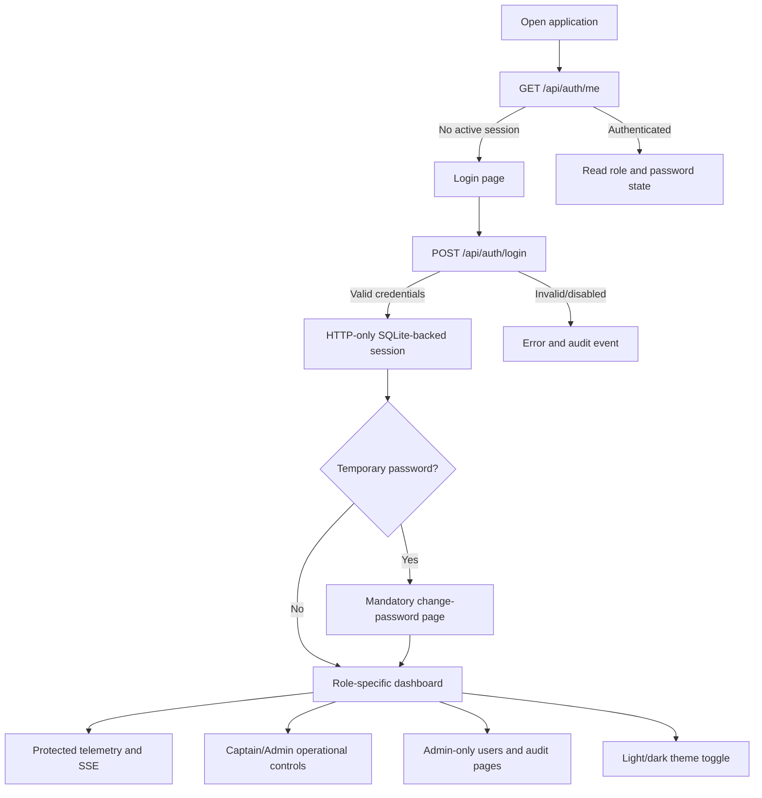
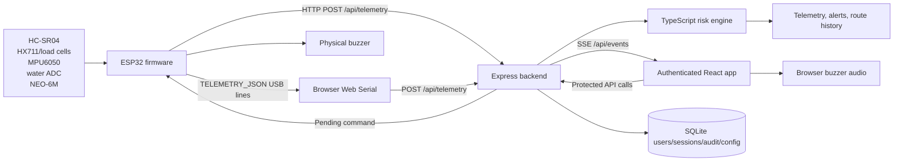
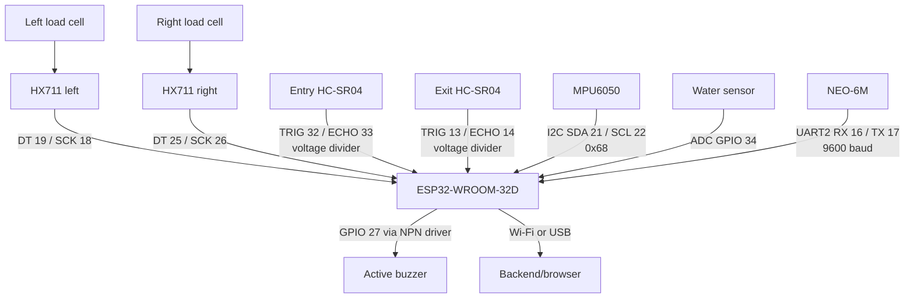
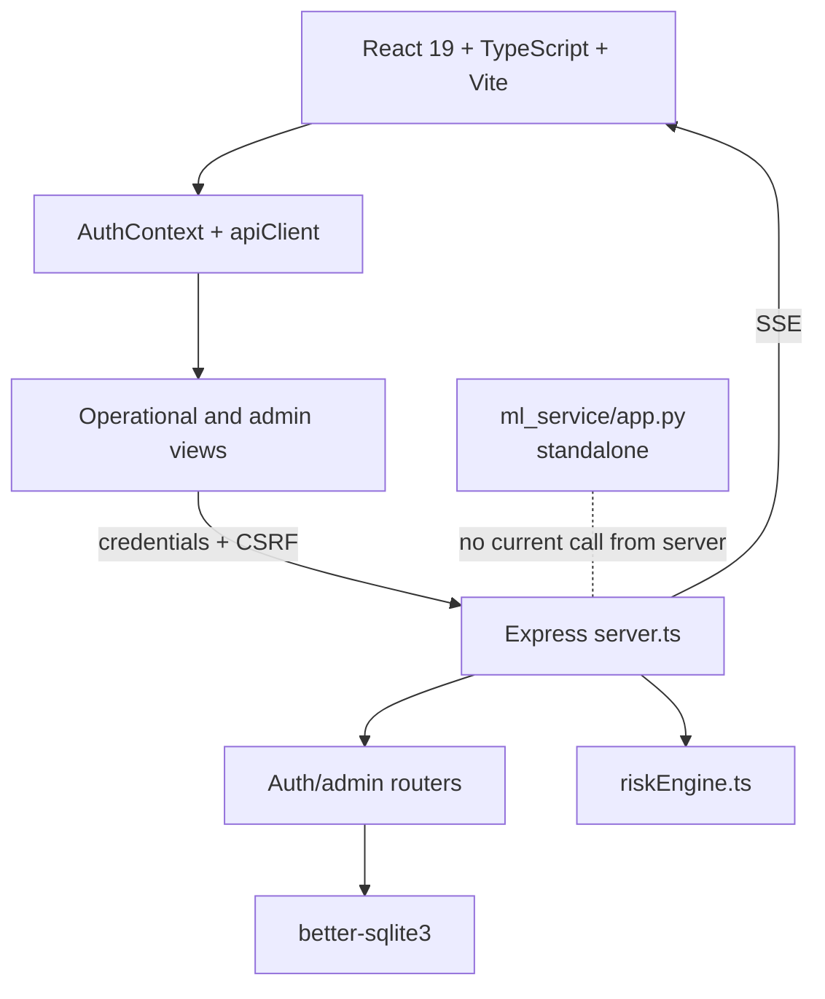
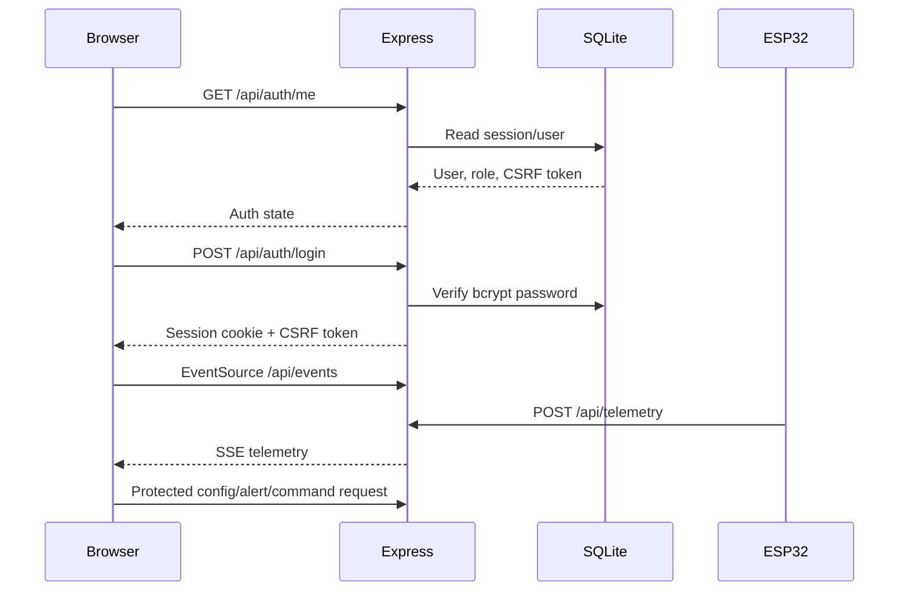

# AIoT Smart Launch Risk Assessment System

Real-time passenger, loading, stability, bilge-water, GPS, hardware-health, and role-based operational monitoring for Bangladesh river launches.


> **Prototype status:** This repository contains a functional React/Express application, local authentication system, and ESP32 prototype firmware. It is not a certified maritime safety system. Validate vessel-specific limits, sensor placement, electrical installation, calibration, network reliability, and emergency procedures with qualified engineers and maritime authorities before operational use.

## Table of contents

- [System overview](#system-overview)
- [What is implemented](#what-is-implemented)
- [Application flow](#application-flow)
- [Architecture](#architecture)
- [Authentication and roles](#authentication-and-roles)
- [Hardware](#hardware)
- [ESP32 firmware](#esp32-firmware)
- [Risk assessment](#risk-assessment)
- [Backend and API](#backend-and-api)
- [Machine-learning service](#machine-learning-service)
- [Web pages](#web-pages)
- [Theme support](#theme-support)
- [Installation](#installation)
- [Initial admin setup](#initial-admin-setup)
- [Configuration](#configuration)
- [Calibration](#calibration)
- [Simulation and hardware modes](#simulation-and-hardware-modes)
- [Troubleshooting](#troubleshooting)
- [Project structure](#project-structure)
- [Limitations and roadmap](#limitations-and-roadmap)

## System overview

Bangladesh depends heavily on passenger launches and ferries operating on the Buriganga, Meghna, Padma, and connected river routes. Overcrowding, uneven passenger or cargo distribution, excessive roll/pitch, and water ingress can develop quickly during boarding or navigation. This system combines an ESP32 sensor unit, a protected web dashboard, and an explainable risk engine to make those conditions visible to operators and oversight users.

The current system:

- Counts entries and exits with two HC-SR04 ultrasonic gates.
- Measures left/right prototype loading with two load cells and HX711 amplifiers.
- Calculates roll and pitch from an MPU6050.
- Estimates calibrated water coverage from an analog sensor.
- Reads position, speed, course, and satellite count from a NEO-6M GPS.
- Sends telemetry over ESP32 Wi-Fi HTTP or USB Web Serial.
- Evaluates risk in the TypeScript backend engine.
- Pushes live telemetry to the browser through Server-Sent Events (SSE).
- Stores application users, sessions, and audit logs in SQLite.
- Provides role-specific access for administrators, captains, and authorities.
- Supports light/dark theme preference persisted in browser local storage.

### Implementation status

| Capability | Status |
|---|---|
| Passenger counting and capacity assessment | Implemented in firmware, simulation, backend, and dashboard |
| Left/right load and imbalance | Implemented when both HX711 channels are valid |
| Roll/pitch stability monitoring | Implemented with MPU6050 |
| Water ingress monitoring | Implemented with dry/wet calibration |
| GPS tracking and route history | Implemented |
| Real-time alerts and browser/physical buzzer states | Implemented |
| Short-term telemetry/history analytics | Implemented in process memory |
| Local authentication and role-based authorization | Implemented with Express sessions and SQLite |
| Admin user management and audit logs | Implemented for `ADMIN` |
| Persistent telemetry database | Not implemented; the generated MySQL schema is future-oriented |
| Active ML inference in the dashboard | Not implemented; `ml_service` is standalone and not called by `server.ts` |
| SMS, email, push, or external BIWTA notification | Not implemented |

## Application flow



## Architecture

### End-to-end data flow



### Hardware architecture



### Software architecture



### Frontend/backend sequence



## Authentication and roles

Authentication was added in the latest application flow. The browser does not open the operational dashboard anonymously.

### Session security

- Credentials are checked with `bcryptjs`.
- Sessions use `express-session` with a custom SQLite store.
- The cookie is named `smart_launch.sid`, HTTP-only, and configured for local application use.
- Session IDs are regenerated after successful login to reduce session fixation risk.
- Sessions have an absolute lifetime of eight hours in the SQLite store and an inactivity timeout of 30 minutes by default.
- Mutating requests require a session CSRF token in `X-CSRF-Token`.
- Login failures are rate-limited to 10 failed attempts per 15-minute window.
- Authentication, authorization, password, and account-management events are written to `audit_logs`.
- Disabled accounts lose active sessions.
- Temporary passwords force the user to the password-change page before normal access.

### Roles and permissions

| Role | Intended user | Access |
|---|---|---|
| `ADMIN` | System administrator | All monitoring, simulation, commands, calibration, settings, hardware tools, user management, and audit logs |
| `CAPTAIN` | Vessel operator | Dashboard, live monitoring, tracking, alerts, analytics, operational simulation/hardware mode, buzzer and operations controls |
| `AUTHORITY` | Monitoring/oversight user | Read-only dashboard, live monitoring, tracking, alerts, and analytics |

The backend permission policy is authoritative. `ADMIN` is the only role permitted to manage users, change configuration, issue hardware commands, or read audit logs. The primary admin cannot be promoted/demoted, deleted, or deactivated through the standard admin API. Admins can create only `CAPTAIN` and `AUTHORITY` accounts.

### Permission matrix

| Permission | ADMIN | CAPTAIN | AUTHORITY |
|---|:---:|:---:|:---:|
| `telemetry:read` | Yes | Yes | Yes |
| `alerts:read` | Yes | Yes | Yes |
| `alerts:acknowledge` | Yes | Yes | No |
| `operations:control` | Yes | Yes | No |
| `config:read` | Yes | Yes | Yes |
| `config:write` | Yes | No | No |
| `users:manage` | Yes | No | No |
| `audit:read` | Yes | No | No |
| `hardware:admin` | Yes | No | No |

The frontend hides unavailable navigation items, but all important restrictions are also enforced on the server. Unauthorized attempts generate an audit event.

## Hardware

### Components

| Component | Purpose | Interface | Safety contribution |
|---|---|---|---|
| ESP32-WROOM-32D | Sensor controller, Wi-Fi client, serial endpoint | GPIO, I2C, UART2, ADC, Wi-Fi | Aggregates sensors and controls local buzzer |
| HC-SR04 entry gate | Detects boarding entries | TRIG 32, ECHO 33 | Increments passenger count |
| HC-SR04 exit gate | Detects exits | TRIG 13, ECHO 14 | Decrements passenger count |
| Two load cells | Measures left/right prototype load | One HX711 per side | Total load and distribution |
| Two HX711 modules | Load-cell ADC/amplifiers | Left 19/18, right 25/26 | Independent side measurements |
| MPU6050 | Accelerometer and gyroscope | I2C 21/22, address `0x68` | Roll and pitch |
| Analog water sensor | Hull/bilge water estimate | ADC GPIO34 | Water-ingress warning |
| NEO-6M GPS | Position, speed, course, satellites | UART2 16/17, 9600 baud | Route and location context |
| Active buzzer | Local audible alarm | GPIO27 through NPN driver | Physical warning |

### ESP32 GPIO mapping

| Signal | GPIO | Notes |
|---|---:|---|
| Left HX711 DT / SCK | 19 / 18 | `LEFT_DT_PIN`, `LEFT_SCK_PIN` |
| Right HX711 DT / SCK | 25 / 26 | `RIGHT_DT_PIN`, `RIGHT_SCK_PIN` |
| MPU6050 SDA / SCL | 21 / 22 | I2C, `0x68` |
| Water sensor | 34 | ADC1_CH6, input-only |
| Buzzer driver | 27 | NPN transistor base |
| GPS RX / TX | 16 / 17 | ESP32 UART2 |
| Entry TRIG / ECHO | 32 / 33 | Echo via 1 kΩ/2 kΩ divider |
| Exit TRIG / ECHO | 13 / 14 | Echo via 1 kΩ/2 kΩ divider |

**Electrical warning:** ESP32 GPIO is 3.3 V logic. HC-SR04 Echo is commonly 5 V and must not be connected directly to an ESP32 input. Use the specified voltage divider, common ground, regulated power, and suitable protection. Do not treat prototype wiring as a certified marine electrical installation.

## ESP32 firmware

Source: [`firmware/smart_launch_esp32.ino`](firmware/smart_launch_esp32.ino)

### Runtime flow

`setup()` starts serial at 115200 baud, configures ADC/GPIO, restores water references and passenger counters from ESP32 Preferences, initializes GPS at 9600 baud, initializes/calibrates the MPU6050, initializes and tares both HX711 channels, connects Wi-Fi, and prints commands.

`loop()` updates GPS, handles commands, reads both load cells, reads MPU6050, averages/calibrates water ADC, alternates ultrasonic gates, calculates local buzzer conditions, sends telemetry approximately every 1.2 seconds, and prints a report once per second.

### Passenger detection

Entry and exit sensors are pinged alternately with a 70 ms gap. A distance from 2–15 cm must be detected in two samples. After an event, the gate must clear for three samples at 20 cm or more before re-arming. Entries increment `totalEntries` and `passengerCount`; exits increment `totalExits` and decrement onboard count only when it is above zero. Unmatched exits are counted separately.

### Load and tilt calculations

```text
totalWeight = leftWeight + rightWeight
imbalance (%) = |leftWeight - rightWeight| / totalWeight × 100

pitch = atan2(-ax, sqrt(ay² + az²)) × 180 / π
roll  = atan2(ay, az) × 180 / π
```

The firmware uses prototype gram readings and calibration factors `695.416` and `706.785`. The TypeScript interfaces use `kg` field names, so production deployments must standardize units before relying on thresholds.

### Water and GPS

Sixteen ADC samples are averaged. After dry and wet calibration:

```text
coverage (%) = (raw - dryRaw) / (wetRaw - dryRaw) × 100
```

Values are clamped to 0–100%; a dry/wet difference below 50 ADC counts fails calibration. References are persisted in Preferences. GPS is valid when TinyGPSPlus reports a valid location younger than five seconds.

### Firmware commands

| Command | Action |
|---|---|
| `d` | Capture/save dry water ADC reference |
| `w` | Capture/save wet water ADC reference; `d` first |
| `t` | Tare both load cells |
| `m` | Calibrate MPU6050 level and gyro bias using 100 samples |
| `z` | Reset passenger counters and gate states |

Commands can be entered in Arduino Serial Monitor or queued from the admin Calibration/Hardware & Code pages. The firmware sends a `TELEMETRY_JSON:` line over USB and can POST the same payload to `/api/telemetry`.

### Firmware upload

1. Install Arduino IDE and the ESP32 board package.
2. Install **TinyGPSPlus** and **HX711**; `WiFi`, `HTTPClient`, `Wire`, and `Preferences` come from the ESP32 core.
3. Open the `.ino` file.
4. Configure Wi-Fi credentials and `SERVER_URL`; never commit real credentials.
5. Select an ESP32-WROOM-32D-compatible board and port.
6. Upload and open Serial Monitor at 115200 baud.
7. Verify dividers, grounds, power, and sensor responses before applying operational loads.

## Risk assessment

The active dashboard risk engine is [`src/utils/riskEngine.ts`](src/utils/riskEngine.ts). It is explainable rule-based logic, not trained AI.

### Score bands

| Score | Level |
|---:|---|
| 0–24 | `SAFE` |
| 25–49 | `WARNING` |
| 50–74 | `HIGH RISK` |
| 75–100 | `CRITICAL` |

### Current rules

| Factor | Rule | Contribution |
|---|---|---:|
| Passenger capacity | ≥90%, >105%, >125% of capacity | 12 / 25 / 35 |
| Total load | ≥88%, >102%, >120% of configured maximum | 6 / 15 / 25 |
| Load imbalance | Dual HX711 valid; above configured threshold or 1.5× threshold | 14 / 25 |
| Roll | At warning or critical angle | 22 / 40 |
| Pitch | At warning or critical angle | 10 / 20 |
| Water | At warning or critical percentage | 25 / 45 |

Scores are added and clamped to 100. Critical water or critical roll forces at least 85. Severe overcrowding or severe imbalance forces at least 75. Warning water, warning roll, or overcrowding above 105% forces at least 50.

The initial server configuration uses 500 passengers, `maxLoadKg: 2000`, 10% imbalance, 5°/10° roll and pitch, and 25%/60% water thresholds. The firmware has separate prototype thresholds: 5°/10° tilt, 10%/20% imbalance, 25%/60% water, and 800 g/1000 g side load. Reconcile these values and units for a real deployment.

### Alert and buzzer mapping

The server maps `SAFE` to `OFF`, `WARNING` to `INTERMITTENT_WARNING`, `HIGH RISK` to `RAPID_HIGH_RISK`, and `CRITICAL` to `CONTINUOUS_ALARM`. Repeated same-level alerts are suppressed for approximately one minute. The browser can generate audio patterns; the ESP32 controls the physical buzzer independently.

## Backend and API

Source: [`server.ts`](server.ts)

The backend runs Express with Vite middleware in development and serves `dist/` in production. Telemetry, alerts, route points, and current vessel configuration remain in process memory. Authentication data is persisted in SQLite at `./data/smart_launch.db` by default.

### Authentication endpoints

| Method | Endpoint | Purpose |
|---|---|---|
| `GET` | `/api/auth/me` | Return current session, user, CSRF token, and admin-provisioned state |
| `GET` | `/api/auth/csrf` | Bootstrap/read CSRF token |
| `POST` | `/api/auth/login` | Validate credentials and create a session |
| `POST` | `/api/auth/logout` | Destroy the current session |
| `POST` | `/api/auth/change-password` | Change current password and clear temporary-password state |

### Admin endpoints

All admin endpoints require an authenticated active `ADMIN` with a changed password and CSRF protection for mutations.

| Method | Endpoint | Purpose |
|---|---|---|
| `GET` | `/api/admin/users` | List/search/filter users |
| `GET` | `/api/admin/users/generate-password` | Generate a secure temporary password |
| `POST` | `/api/admin/users` | Create `CAPTAIN` or `AUTHORITY` |
| `PATCH` | `/api/admin/users/:id` | Edit name, email, role, or active status |
| `POST` | `/api/admin/users/:id/reset-password` | Reset Captain/Authority password and invalidate sessions |
| `DELETE` | `/api/admin/users/:id` | Delete Captain/Authority account |
| `GET` | `/api/admin/audit-logs` | Filter and read audit events |

### Protected operational endpoints

| Method | Endpoint | Purpose | Access |
|---|---|---|---|
| `POST` | `/api/telemetry` | Receive ESP32 telemetry and evaluate risk | Authenticated device/dashboard flow |
| `GET` | `/api/telemetry/latest` | Current telemetry, mode, heartbeat, config | Authenticated |
| `GET` | `/api/telemetry/history` | Bounded telemetry and GPS history | Authenticated |
| `GET` | `/api/events` | SSE live telemetry stream | Authenticated browser session |
| `POST` | `/api/simulation/state` | Change simulation values or mode | Admin/Captain |
| `GET` | `/api/config` | Read vessel configuration | Authenticated |
| `POST` | `/api/config` | Merge configuration | Admin |
| `GET` | `/api/alerts` | Read alerts | Authenticated |
| `POST` | `/api/alerts/acknowledge` | Acknowledge alert | Admin/Captain |
| `POST` | `/api/buzzer/mute` | Toggle browser/backend mute state | Admin/Captain |
| `POST` | `/api/device/command` | Queue firmware command | Admin |
| `GET` | `/api/schema/mysql` | Download future MySQL schema | Admin |
| `GET` | `/firmware/smart_launch_esp32.ino` | Download firmware source | Admin |

`apiClient.ts` sends credentials, attaches the CSRF token to mutating requests, and redirects to login on unauthorized responses. The ESP32 HTTP endpoint is intended for the configured device telemetry path; protect deployments with an appropriate network boundary because the prototype does not implement device tokens.

### Telemetry shape

```json
{
  "deviceId": "LAUNCH-BD-8902",
  "passengerCount": 215,
  "entryCount": 230,
  "exitCount": 15,
  "leftLoad": 9200,
  "rightLoad": 9100,
  "totalLoad": 18300,
  "loadImbalancePercent": 0.5,
  "roll": 1.4,
  "pitch": 0.8,
  "waterLevelRaw": 280,
  "waterLevelPercent": 5.2,
  "gps": {
    "fixValid": true,
    "latitude": 23.7042,
    "longitude": 90.4183,
    "speedKmh": 18.5,
    "course": 142,
    "satellites": 9
  }
}
```

## Machine-learning service

Source: [`ml_service/app.py`](ml_service/app.py)

The optional Flask service exposes `GET /health` and `POST /predict_risk`. It creates a feature vector from capacity ratio, absolute roll, absolute pitch, water percentage, and imbalance percentage. If `launch_risk_model.joblib` exists, it calls `model.predict`; otherwise it uses the local fallback rule scorer.

No model file is committed, and `server.ts` does not call this service. The production dashboard therefore uses `src/utils/riskEngine.ts`, not ML predictions. The service is an extension point for a future trained model and must not be presented as active AI inference in the current deployment.

## Web pages

The app uses path-aware tab state in `src/App.tsx`; authenticated users are routed to role-appropriate pages. Admin-only pages are not shown to other roles and are also server-protected.

### Login

The login page accepts email/password, shows the current theme toggle, and reports invalid credentials, disabled accounts, rate limiting, and session errors. Successful login stores the session cookie and CSRF token through the auth context.

### Dashboard

Shows the risk gauge, vessel identity, capacity, left/right load, attitude, water, GPS/map summary, hardware health, recent alerts, recommended action, and buzzer controls. Admin/Captain users can open simulation and operational controls; Authority users receive read-only oversight.


### Live Monitoring

Displays recent passenger, roll, pitch, water, and risk time series from the SSE-backed sliding history.


### Vessel Tracking

Displays GPS fix state, coordinates, speed, course, satellites, route points, and GeoJSON export.


### Alerts

Filters alerts by risk level, displays category/details/recommended action, and allows authorized users to acknowledge them.


### History & Analytics

Calculates peak/average passengers, maximum roll, water, and risk from bounded in-memory history. Users can switch metrics and export CSV.


### Calibration

Admin-only controls queue dry/wet water calibration, load-cell tare, MPU6050 calibration, and passenger counter reset. Configuration values are saved through the protected config endpoint; firmware calibration commands must reach the board over USB or the next telemetry response.


### Settings

Admin-only vessel identity, capacity, load, imbalance, tilt, water, ultrasonic, calibration, and serial timing settings. Values are merged into the server's runtime configuration.


### Hardware & Code

Admin-only hardware pinout, server target, firmware download/code preview, MySQL schema download, Web Serial connection, serial logs, cURL material, and firmware command controls.


### User Management

Admin-only page for searching/filtering users, creating Captain/Authority accounts, generating or displaying temporary passwords, editing profile details, switching Captain/Authority roles, activating/deactivating accounts, resetting passwords, and deleting non-admin accounts.

### Audit Logs

Admin-only page for authentication and administration events. It filters events such as `LOGIN_SUCCESS`, `LOGIN_FAILED`, `LOGOUT`, `USER_CREATED`, `USER_DEACTIVATED`, `USER_ACTIVATED`, `USER_PASSWORD_RESET`, `PASSWORD_CHANGED`, `ROLE_CHANGED`, `USER_DELETED`, and `UNAUTHORIZED_ACCESS`.

### Change Password and Access Denied

All authenticated users can open Change Password. Users with a temporary password are forced there before accessing normal pages. Access Denied is shown when a valid user attempts a page outside the role policy.

## Theme support

The application supports light and dark themes through `ThemeContext`:

- The Navbar and Login page expose a theme toggle.
- The selected theme is stored as `smart_launch_theme` in `localStorage`.
- The root document receives `data-theme="light"` or `data-theme="dark"` and the `dark` class.
- Shared CSS variables and Tailwind dark variants update surfaces, text, borders, charts, maps, and controls.
- The default theme is light when no saved preference exists.

Theme preference is local to the browser and is not stored in the server database.

## Installation

### Requirements

- Node.js compatible with the repository toolchain.
- Bun is supported through the committed `bun.lock`; npm also works.
- Python 3 for the optional ML service.
- Arduino IDE and ESP32 board package for firmware.
- Chrome or Edge desktop for Web Serial.

### Install and run

```bash
git clone https://github.com/Jotimoy/AIoT-Smart-Launch-Risk-Assessment.git
cd AIoT-Smart-Launch-Risk-Assessment

npm install
npm run setup:admin
npm run dev
```

Open `http://localhost:3000`. With Bun:

```bash
bun install
bun run setup:admin
bun run dev
```

Useful scripts:

| Script | Purpose |
|---|---|
| `dev` / `start` | Run `tsx server.ts` |
| `build` | Build the frontend |
| `preview` | Preview a Vite build |
| `lint` | TypeScript check |
| `test` | Risk-engine and authentication tests |
| `setup:admin` | Provision the first admin |
| `clean` | Remove build outputs |

Set `PORT` to use another port:

```bash
PORT=3001 npm run dev
```

### Environment file

```bash
cp .env.example .env
```

Important values:

```dotenv
SESSION_SECRET=use-a-long-random-secret
SQLITE_DB_PATH=./data/smart_launch.db
SESSION_INACTIVITY_MS=1800000
INITIAL_ADMIN_EMAIL=admin@smartlaunch.local
INITIAL_ADMIN_PASSWORD=
INITIAL_ADMIN_NAME=System Administrator
```

`GEMINI_API_KEY` and `APP_URL` remain in `.env.example` for the hosting environment, but the current source does not use Gemini in the active risk flow. Never commit secrets.

### Optional ML service

The repository does not include a Python dependency manifest:

```bash
cd ml_service
python3 -m venv .venv
. .venv/bin/activate
python -m pip install flask numpy joblib scikit-learn
python app.py
```

The service listens on port 5001 by default and is not started by `npm run dev`.

## Initial admin setup

The application refuses to create a second initial `ADMIN` through the bootstrap path. Run one of these once:

```bash
npm run setup:admin
```

Interactive setup asks for name, email, and a strong password. For local development, generate a secure password automatically:

```bash
npm run setup:admin -- --generate
```

Or configure environment variables:

```bash
INITIAL_ADMIN_EMAIL="admin@smartlaunch.local" \
INITIAL_ADMIN_PASSWORD="YourStrong!Password1" \
npm run setup:admin
```

The password is stored only as a bcrypt hash. Save generated credentials securely. On first login, any account created with a temporary password must change it before normal access.

## Configuration

Runtime configuration is read from `GET /api/config` and saved by `ADMIN` through `POST /api/config`. Important fields include:

```json
{
  "maxPassengerCapacity": 500,
  "maxLoadKg": 2000,
  "maxLoadImbalancePercent": 10,
  "warningRollAngle": 5,
  "criticalRollAngle": 10,
  "warningPitchAngle": 5,
  "criticalPitchAngle": 10,
  "warningWaterLevelPercent": 25,
  "criticalWaterLevelPercent": 60,
  "dualHX711Mode": true,
  "esp32BaudRate": 115200,
  "gpsUartBaudRate": 9600,
  "apiHeartbeatIntervalSec": 2
}
```

The ESP32 Wi-Fi credentials, URL, device ID, pin mapping, firmware factors, and local thresholds remain constants in the `.ino` file. Dashboard configuration does not rewrite firmware flash.

## Calibration

Perform calibration with the prototype secured and the correct role/session.

### Load cells

1. Remove all weight.
2. Send `t` from Serial Monitor or the admin Calibration page.
3. Apply known reference loads independently to each side.
4. Adjust scale factors (`695.416` left and `706.785` right in the committed prototype).
5. Verify balanced and deliberately unbalanced readings.

The firmware performs tare in the current running session; dashboard tare/scale fields are server configuration and are not automatically written to firmware flash.

### MPU6050

1. Mount the sensor in the vessel reference orientation.
2. Keep the model level and still.
3. Send `m`.
4. Wait for 100 samples and a success message.
5. Check known roll/pitch directions.

### Water sensor

1. Keep the sensor completely dry and send `d`.
2. Put it at the wet reference and send `w`.
3. Ensure the ADC difference is at least 50 counts.
4. Verify coverage rises from 0% toward 100%.

Dry/wet references and passenger counters are saved in ESP32 Preferences. MPU offsets and load-cell scale factors are not persisted by the firmware.

## Simulation and hardware modes

### Simulation mode

Simulation is the default backend mode. A two-second ticker moves the seeded GPS position along a Bangladesh river route and applies small roll/pitch/speed variations. Admins and Captains can open the Simulation Drawer and post partial telemetry to exercise alerts and charts. Authority users are read-only.

Simulation values are synthetic and cannot validate wiring, sensor noise, GPS reception, physical loading, or vessel stability.

### Real hardware mode

The ESP32 sends HTTP telemetry approximately every 1.2 seconds when Wi-Fi is available and always prints `TELEMETRY_JSON:` over USB. The browser Web Serial bridge forwards those lines to the authenticated backend. The backend returns one queued command in the telemetry response.

If real telemetry is absent for more than eight seconds, the latest endpoint marks ESP32 Wi-Fi unhealthy and GPS stale. The firmware comments mention an offline ring buffer, but the current sketch does not implement replay storage; offline behavior is local serial output and buzzer operation.

## Troubleshooting

| Problem | Diagnosis and solution |
|---|---|
| Login fails | Check email/password, account active state, and audit logs. Avoid repeated attempts because login failures are rate-limited. |
| Temporary password blocks dashboard | Open Change Password and set a strong password with upper/lowercase, number, and symbol. |
| CSRF error | Refresh the page to bootstrap a new token and retry. Do not remove CSRF checks. |
| Session expires | Default inactivity timeout is 30 minutes; sign in again or change `SESSION_INACTIVITY_MS` for local testing. |
| Admin page is hidden | Only `ADMIN` can access user management, audit logs, calibration, settings, and hardware tools. |
| SQLite database cannot open | Check `SQLITE_DB_PATH`, directory permissions, and whether the `data` directory can be created. |
| ESP32 not detected | Use a data USB cable, correct board/port, and close other serial tools. |
| Telemetry does not arrive | Check Wi-Fi, `SERVER_URL`, server reachability, and backend logs. |
| SSE has no updates | Confirm a valid authenticated session and `/api/events`; inspect browser console/network tools. |
| HX711 is not ready | Check DT/SCK 19/18 and 25/26, wiring, power, common ground, and load-cell connections. |
| Load readings are wrong | Remove load, tare, apply a known reference, and reconcile prototype grams with configured units. |
| MPU6050 fails | Verify SDA21/SCL22, address `0x68`, power, and run `m` only after initialization succeeds. |
| Ultrasonic counts are unreliable | Verify Echo dividers, sensor spacing, 2–15 cm trigger zone, and 20 cm clear distance. |
| GPS has no fix | Check RX/TX orientation, 9600 baud, antenna sky view, and cold-start wait time. |
| Water calibration fails | Repeat dry/wet calibration with stable readings and at least 50 ADC counts of difference. |
| Buzzer is silent | Check GPIO27/NPN driver/polarity and distinguish physical buzzer from browser mute. |
| Web Serial unavailable | Use desktop Chrome/Edge in a full tab at 115200 baud. |
| ML service unavailable | Install Python dependencies and start `python app.py`; it is optional and not called by the dashboard. |
| History disappears | Telemetry and alerts are process-memory only; SQLite currently stores authentication/config support, not telemetry history. |

## Project structure

```text
AIoT-Smart-Launch-Risk-Assessment/
├── firmware/
│   └── smart_launch_esp32.ino       # ESP32 sensors, alarms, telemetry
├── ml_service/
│   └── app.py                        # Optional standalone Flask service
├── server/
│   ├── auth/
│   │   ├── adminBootstrap.ts         # First-admin provisioning
│   │   ├── auth.test.ts              # Authentication/authorization tests
│   │   ├── middleware.ts             # Sessions, CSRF, auth guards
│   │   ├── rbac.ts                   # Role permissions
│   │   ├── sqliteSessionStore.ts     # SQLite express-session store
│   │   └── validation.ts              # Email/password/role validation
│   ├── db/
│   │   └── database.ts               # SQLite schema and user/audit queries
│   └── routes/
│       ├── authRoutes.ts              # Login/session/password APIs
│       └── adminRoutes.ts             # Admin user/audit APIs
├── scripts/
│   └── setup-admin.ts                # CLI initial-admin setup
├── docs/screenshots/                 # Captured UI screenshots
├── src/
│   ├── components/                   # Gauges, map, navbar, simulator
│   ├── context/
│   │   ├── AuthContext.tsx            # Session and login state
│   │   └── ThemeContext.tsx           # Light/dark preference
│   ├── views/                        # Operational, auth, and admin pages
│   ├── types/
│   │   ├── auth.ts                   # User roles and audit types
│   │   └── iot.ts                    # Telemetry/config/alert types
│   ├── utils/
│   │   ├── apiClient.ts               # Credentialed fetch + CSRF
│   │   ├── riskEngine.ts              # Active risk calculation
│   │   ├── riskEngine.test.ts         # Risk tests
│   │   ├── webSerialBridge.ts         # USB telemetry/commands
│   │   └── buzzerAudio.ts              # Browser alarm audio
│   ├── App.tsx                       # Auth routing and application state
│   └── main.tsx                      # React providers and entry point
├── server.ts                          # Express/Vite server and telemetry APIs
├── package.json                       # Scripts and dependencies
├── bun.lock                           # Bun lockfile
├── .env.example                       # Runtime/auth placeholders
├── LOCAL_AUTH_GUIDE.md                # Authentication setup reference
└── README.md
```

## Validation

Run the repository checks after installation:

```bash
npm run lint
npm test
npm run build
```

The test script runs both the risk-engine tests and `server/auth/auth.test.ts`.

## Limitations and roadmap

Proposed future work, not current functionality:

- Persist telemetry, alerts, vessel records, and calibration history in a production database.
- Add device authentication, request validation, HTTPS deployment guidance, and production cookie/security policy.
- Integrate the ML service behind an explicit fallback and train it with labeled maritime data.
- Add SMS/push notifications, tested escalation workflows, and multiple-vessel fleet monitoring.
- Add offline telemetry synchronization, route geofencing, weather/current context, and predictive maintenance.
- Persist firmware calibration factors and add hardware-in-the-loop tests, watchdog recovery, and signed firmware.
- Reconcile prototype grams/kg fields and validate all thresholds against marine instrumentation and stability certification.

## Source coverage

This README reflects the latest repository flow, including `server.ts`, the authentication middleware/routes/database, `scripts/setup-admin.ts`, `LOCAL_AUTH_GUIDE.md`, `src/App.tsx`, `AuthContext`, `ThemeContext`, `apiClient`, all operational/admin/auth views, `src/utils/riskEngine.ts`, the ESP32 firmware, ML service, package scripts, environment configuration, and committed screenshots.
