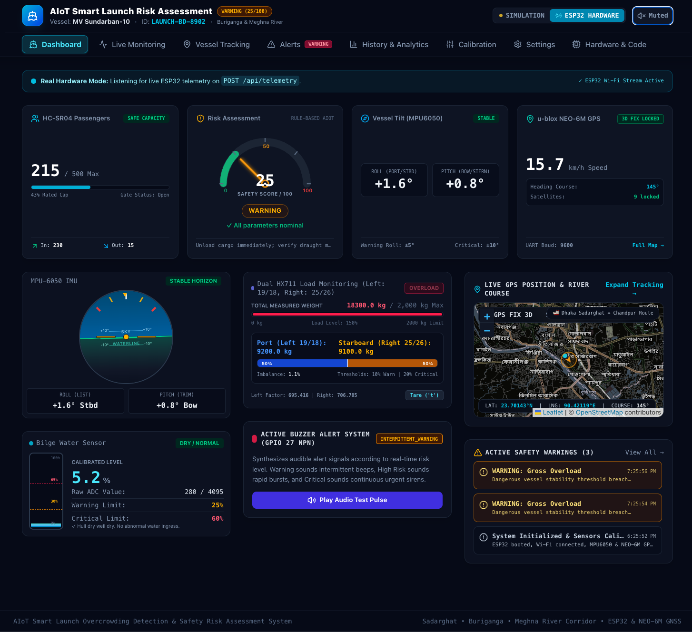
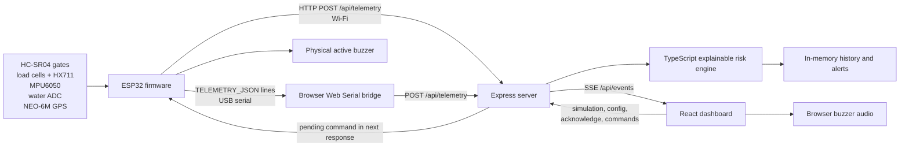
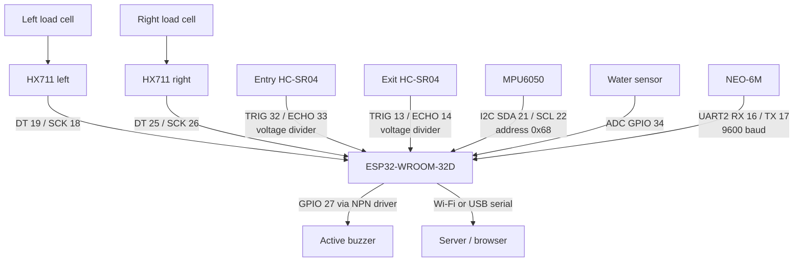
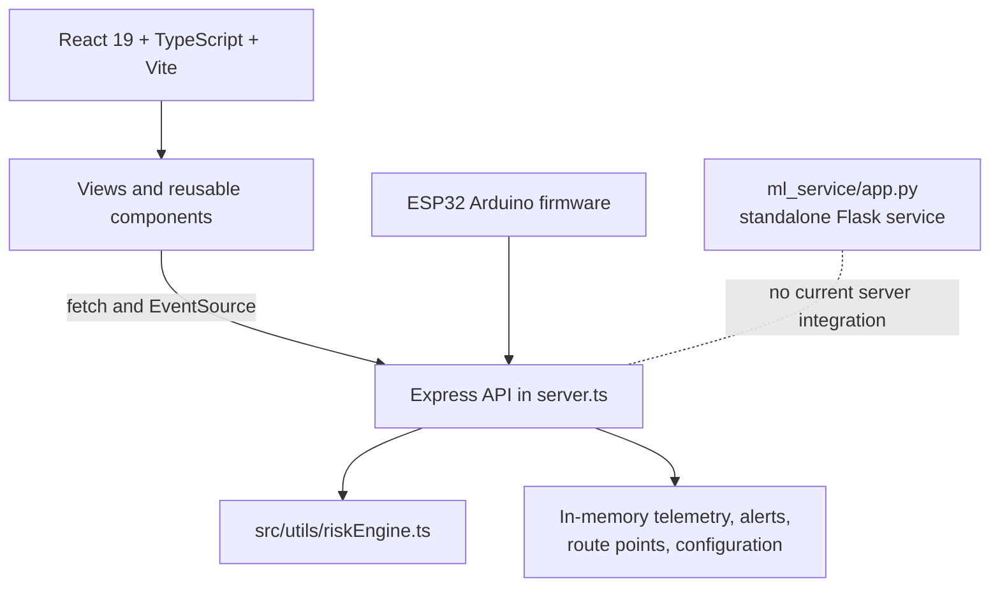
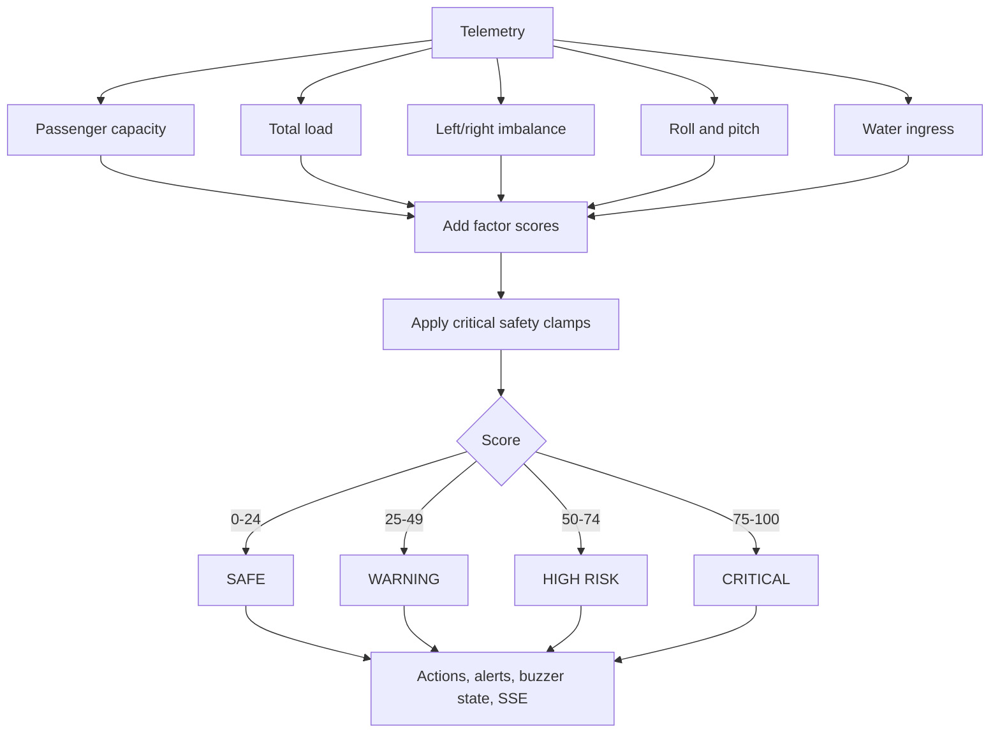
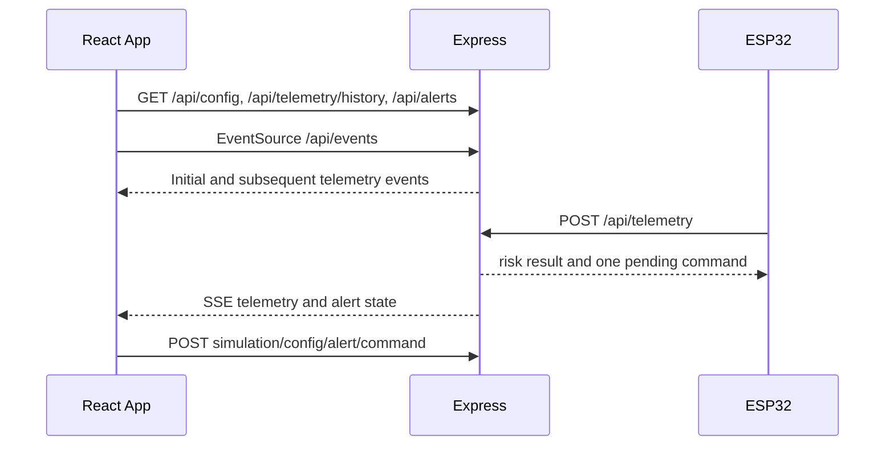
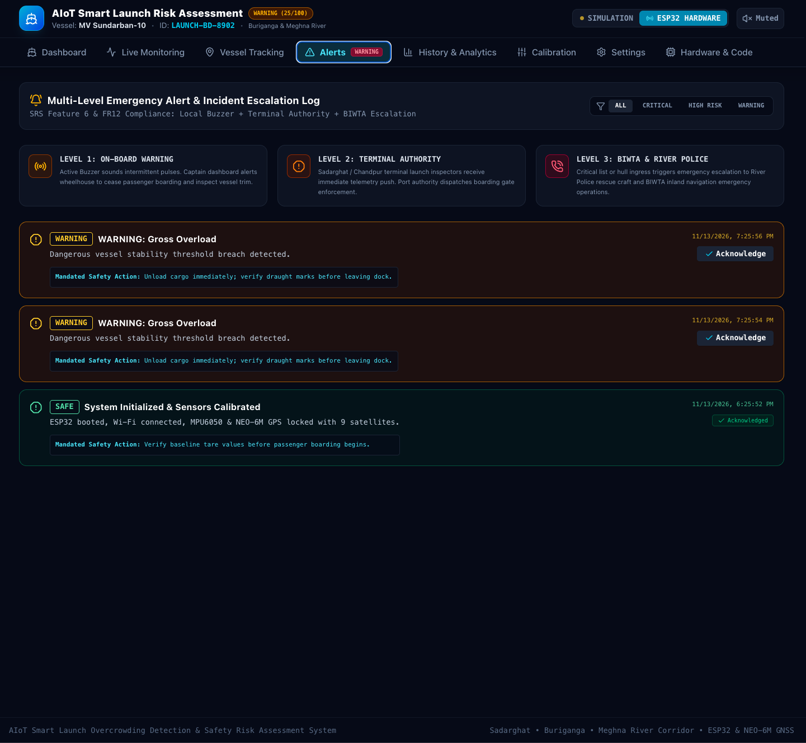
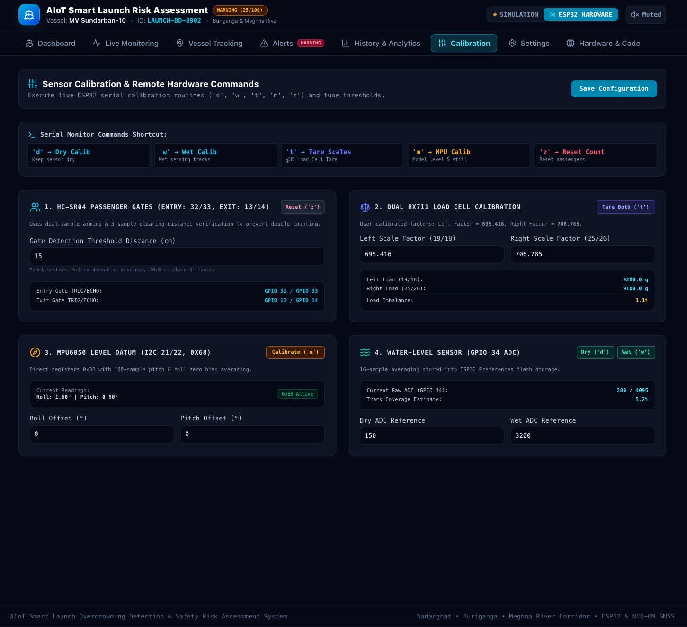
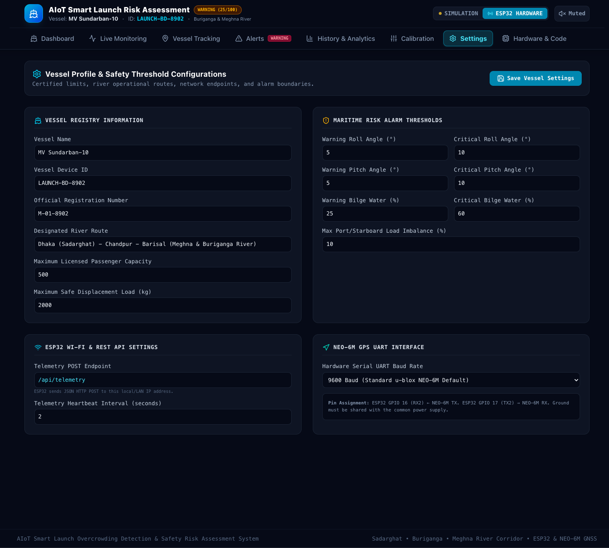

# AIoT Smart Launch Risk Assessment System

Real-time passenger, loading, stability, bilge-water, GPS, and hardware-health monitoring for Bangladesh river launches.



> **Prototype status:** The repository contains a functional React/Express simulation application and ESP32 firmware for a physical prototype. It is not a certified maritime safety system. Thresholds, sensor placement, calibration, network reliability, and vessel-specific load limits must be validated by qualified marine and electrical engineers before operational use.

## Table of contents

- [Overview](#overview)
- [What is implemented](#what-is-implemented)
- [Architecture](#architecture)
- [Hardware](#hardware)
- [Firmware](#firmware)
- [Risk assessment](#risk-assessment)
- [Backend and API](#backend-and-api)
- [Machine-learning service](#machine-learning-service)
- [Web application](#web-application)
- [Screenshots](#screenshots)
- [Installation](#installation)
- [Configuration](#configuration)
- [Calibration](#calibration)
- [Simulation and hardware modes](#simulation-and-hardware-modes)
- [Troubleshooting](#troubleshooting)
- [Project structure](#project-structure)
- [Limitations and roadmap](#limitations-and-roadmap)

## Overview

Bangladesh relies heavily on passenger launches and ferries on the Buriganga, Meghna, Padma, and other rivers. A launch can become unsafe when passenger capacity is exceeded, people or cargo accumulate on one side, the hull begins taking water, or the vessel develops excessive roll or pitch. These conditions can change faster than a crew member can estimate visually, particularly during boarding, river turns, bad weather, or reduced visibility.

This project combines low-cost embedded sensors with a browser dashboard to provide an explainable safety picture:

- Two HC-SR04 gates estimate entries and exits.
- Two load-cell channels estimate left/right loading and distribution.
- An MPU6050 measures accelerometer-derived roll and pitch.
- An analog water sensor estimates calibrated hull/bilge water coverage.
- A NEO-6M provides position, speed, course, and satellite information.
- An ESP32 drives a local buzzer and publishes telemetry.
- An Express server evaluates risk, stores a short in-memory history, creates alerts, and broadcasts telemetry over Server-Sent Events (SSE).
- A React dashboard presents live status, maps, charts, calibration controls, alerts, and configuration.

Potential users include launch operators, terminal staff, safety researchers, embedded-systems students, IoT developers, and institutions studying passenger-vessel safety. The design is especially relevant to Bangladesh because it supports a locally deployable prototype that can work over a phone hotspot or local network.

### Objectives supported by the repository

| Objective | Current implementation |
|---|---|
| Passenger counting | Implemented in ESP32 firmware with separate entry and exit ultrasonic gates. |
| Overcrowding detection | Implemented by the TypeScript risk engine and simulation controls. |
| Left/right load monitoring | Implemented with two HX711 channels and load cells. |
| Load-imbalance detection | Implemented when both load channels are valid. |
| Vessel tilt monitoring | Implemented with MPU6050 roll and pitch calculations. |
| Internal water monitoring | Implemented with an analog sensor and dry/wet calibration. |
| GPS tracking | Implemented with NEO-6M parsing and route history. |
| Real-time alerts | Implemented in the backend, browser UI, and buzzer logic. |
| History and analytics | Implemented as bounded in-memory history plus CSV/GeoJSON export. |
| Calibration and diagnostics | Implemented through firmware commands, the Calibration page, Hardware & Code page, and health flags. |
| Cloud database persistence | **Not implemented.** The server currently uses process memory; it only generates a MySQL schema for future use. |
| Active AI prediction in the dashboard | **Not implemented.** The ML service is standalone and is not called by `server.ts`. |

## Architecture

### End-to-end data flow



### Hardware architecture



### Software architecture



### Sensor processing flow

```mermaid
flowchart TD
  G[Alternate entry/exit ultrasonic pings] --> C[Gate debounce state machine]
  C --> PC[Entries, exits, onboard count]
  LC[HX711 readings] --> WT[Left/right grams and total]
  WT --> IMB[|left-right| / total * 100]
  MPU[MPU6050 raw registers] --> ANG[Accelerometer roll/pitch]
  WAT[16-sample ADC average] --> CAL[Dry/wet interpolation]
  GPSR[TinyGPSPlus UART stream] --> FIX[Fix validity and coordinates]
  PC --> T[Telemetry JSON]
  IMB --> T
  ANG --> T
  CAL --> T
  FIX --> T
```

### Risk workflow



### Frontend/backend communication



## Hardware

### Components

| Component | Purpose | Interface in firmware | Safety contribution |
|---|---|---|---|
| ESP32-WROOM-32D development board | Sensor controller, Wi-Fi client, USB serial endpoint | GPIO, I2C, UART2, ADC, Wi-Fi | Aggregates readings and controls the buzzer |
| HC-SR04 ultrasonic sensor (entry) | Detects a person at the entry gate | TRIG GPIO32, ECHO GPIO33 | Increments entries and onboard passengers |
| HC-SR04 ultrasonic sensor (exit) | Detects a person at the exit gate | TRIG GPIO13, ECHO GPIO14 | Increments exits and decrements onboard passengers |
| Two load cells | Measures left and right prototype deck loading | Each connected to an HX711 | Total load and side-to-side distribution |
| Two HX711 amplifiers | Amplifies and digitizes load-cell signals | Left DT/SCK 19/18; right DT/SCK 25/26 | Independent left/right measurements |
| MPU6050 | Accelerometer and gyroscope | I2C, address `0x68`, SDA21/SCL22 | Roll, pitch, and motion/stability indication |
| Analog water sensor | Measures hull/bilge water level after calibration | ADC GPIO34, 12-bit | Water ingress warning and critical alarm |
| NEO-6M GPS | Position, speed, course, satellite count | UART2, RX16/TX17 at 9600 | Location and route history |
| Active buzzer | Local audible alarm | GPIO27 through NPN transistor driver | Immediate local warning independent of browser audio |
| Wi-Fi network | Transports telemetry to the server | ESP32 station mode | Remote dashboard communication |

### ESP32 GPIO mapping

| Signal | GPIO | Notes |
|---|---:|---|
| Left HX711 DT | 19 | `LEFT_DT_PIN` |
| Left HX711 SCK | 18 | `LEFT_SCK_PIN` |
| Right HX711 DT | 25 | `RIGHT_DT_PIN` |
| Right HX711 SCK | 26 | `RIGHT_SCK_PIN` |
| MPU6050 SDA | 21 | I2C |
| MPU6050 SCL | 22 | I2C |
| Water sensor analog signal | 34 | ADC1_CH6, input-only |
| Active buzzer driver | 27 | NPN transistor base |
| GPS RX2 | 16 | ESP32 receives NEO-6M TX |
| GPS TX2 | 17 | ESP32 sends to NEO-6M RX |
| Entry HC-SR04 TRIG | 32 | Output |
| Entry HC-SR04 ECHO | 33 | Input through divider |
| Exit HC-SR04 TRIG | 13 | Output |
| Exit HC-SR04 ECHO | 14 | Input through divider |

**Electrical safety:** ESP32 GPIO is 3.3 V logic. The HC-SR04 Echo output is commonly 5 V and must not be connected directly to an ESP32 input. The firmware comments specify a 1 kΩ/2 kΩ voltage divider on both Echo signals; use a correctly rated divider and verify the resulting voltage. Use common ground, regulated power, suitable protection, and an appropriate transistor/driver for the buzzer. Do not treat the prototype wiring as a certified marine electrical installation.

## Firmware

Source: [`firmware/smart_launch_esp32.ino`](firmware/smart_launch_esp32.ino)

### Initialization and main loop

`setup()` starts USB serial at **115200 baud**, configures the ADC and GPIOs, restores Preferences data, starts GPS UART2 at **9600 baud**, initializes the MPU6050 at address `0x68`, initializes and tares both HX711 channels, reads the initial water sensor value, connects to the configured Wi-Fi network, and prints available commands.

`loop()` repeatedly:

1. Feeds received bytes to TinyGPSPlus and checks whether the fix is less than five seconds old.
2. Processes serial commands.
3. Reads both HX711 channels and marks a channel invalid if it has not produced a reading for 1.5 seconds.
4. Reads MPU6050 acceleration/gyro registers.
5. Averages and calibrates the water ADC.
6. Alternates entry and exit ultrasonic pings with a 70 ms gap.
7. Computes local warning/critical conditions and drives the buzzer.
8. Sends telemetry at most every 1.2 seconds.
9. Prints a human-readable report once per second.

### Passenger counting

Each gate uses an armed/clear state machine. A valid distance is 2–15 cm and must be observed in two samples before an event is recorded. After triggering, the gate must see three clear samples at least 20 cm away (or a timeout) before it can trigger again. An entry increments `totalEntries` and `passengerCount`; an exit increments `totalExits` and decrements `passengerCount` only when it is above zero. Unmatched exits are counted separately.

### Load cells and imbalance

The prototype uses calibration factors `695.416` (left) and `706.785` (right). The firmware reads values in grams, applies a 2 g zero deadband, and calculates:

```text
totalWeight = leftWeight + rightWeight
imbalance (%) = |leftWeight - rightWeight| / totalWeight × 100
```

The imbalance is calculated only when both channels are valid and total weight is at least 5 g. The repository has prototype-unit inconsistencies: TypeScript field names say `kg`, while the firmware explicitly sends prototype weights in grams and the server defaults `maxLoadKg` to `2000`. Calibrate and configure units consistently before using real measurements.

### MPU6050

The firmware configures ±2 g acceleration, ±250 °/s gyro range, and a low-pass filter. It reads 14 bytes beginning at register `0x3B`. Roll and pitch are calculated from the accelerometer:

```text
pitch = atan2(-ax, sqrt(ay² + az²)) × 180 / π
roll  = atan2(ay, az) × 180 / π
```

The `m` command averages 100 valid samples while the vessel is level and still, then stores pitch/roll and gyro zero offsets in RAM for the running session.

### Water sensor

Sixteen ADC samples are averaged. After dry and wet references have been captured:

```text
coverage (%) = (raw - dryRaw) / (wetRaw - dryRaw) × 100
```

The result is clamped to 0–100%. A calibration delta below 50 ADC counts is rejected. Water calibration references are stored in ESP32 Preferences flash.

### GPS

TinyGPSPlus consumes the UART stream. A fix is valid only when the location is valid and its age is below 5 seconds. The payload includes latitude, longitude, speed, course, and satellite count when available.

### Local buzzer behavior

The GPIO27 buzzer is active for critical conditions, double-beeps for warnings, and produces a slower beep when calibrated water is detected. Firmware-local triggers include water, tilt, load-cell capacity, and imbalance; passenger count itself is sent to the server but does not directly trigger the firmware buzzer.

### Firmware serial commands

Commands are case-insensitive and can be entered in Arduino Serial Monitor or sent by the Hardware & Code/Calibration pages:

| Command | Action |
|---|---|
| `d` | Capture and save the dry water ADC reference |
| `w` | Capture and save the wet water ADC reference; `d` must be run first |
| `t` | Tare both HX711 load cells after removing weight |
| `m` | Recalibrate MPU6050 level and gyro bias using 100 samples |
| `z` | Reset entries, exits, onboard count, unmatched exits, and gate state |

### Uploading firmware

1. Install Arduino IDE and the ESP32 board package.
2. Install the libraries used by the source: **TinyGPSPlus**, **HX711**, and the ESP32 core libraries (`WiFi`, `HTTPClient`, `Wire`, `Preferences`).
3. Open `firmware/smart_launch_esp32.ino`.
4. Select an ESP32-WROOM-32D-compatible board and the correct USB port.
5. Set the Serial Monitor to **115200 baud**.
6. Set Wi-Fi credentials and `SERVER_URL` in the sketch. Do not commit real credentials.
7. Verify the Echo voltage dividers and sensor grounds.
8. Upload, open Serial Monitor, and perform calibration before attaching operational loads.

## Risk assessment

The active dashboard risk engine is [`src/utils/riskEngine.ts`](src/utils/riskEngine.ts). It is transparent and rule-based; it is not a learned model.

### Score bands

| Score | Level | Meaning in the implementation |
|---:|---|---|
| 0–24 | `SAFE` | Normal operational limits |
| 25–49 | `WARNING` | Elevated vigilance and possible boarding restriction |
| 50–74 | `HIGH RISK` | Immediate corrective action |
| 75–100 | `CRITICAL` | Emergency response threshold |

Scores are additive and clamped to 100. Critical roll or critical water forces at least 85; severe overcrowding or severe imbalance forces at least 75; warning water, warning roll, or overcrowding above 105% forces at least 50.

### Active formulas and thresholds

| Factor | Logic in `riskEngine.ts` | Score |
|---|---|---:|
| Passenger capacity | `count / maxCapacity`; ≥90% adds 12, >105% adds 25, >125% adds 35 | 12/25/35 |
| Total load | `totalLoad / maxLoad`; ≥88% adds 6, >102% adds 15, >120% adds 25 | 6/15/25 |
| Left/right imbalance | When dual HX711 is valid and total left/right load >50: `abs(left-right) / (left+right) × 100`; above configured limit adds 14, above 1.5× limit adds 25 | 14/25 |
| Roll | `abs(roll)` compared with warning/critical configuration | 22/40 |
| Pitch | `abs(pitch)` compared with warning/critical configuration | 10/20 |
| Water | Calibrated percentage compared with warning/critical configuration | 25/45 |

The server's initial configuration uses 5°/10° roll and pitch thresholds, 25%/60% water thresholds, 10% imbalance, 500 passengers, and `maxLoadKg: 2000`. The React initial fallback contains a different `maxLoadKg` and imbalance value, but it is replaced by `/api/config` when the server is available. The firmware has its own prototype thresholds: 5°/10° tilt, 10%/20% imbalance, 25%/60% water, 800 g/1000 g side load, and 15 cm gate detection. These independent threshold sets should be reconciled for a production deployment.

### Buzzer and alert mapping

The backend maps `SAFE` to `OFF`, `WARNING` to `INTERMITTENT_WARNING`, `HIGH RISK` to `RAPID_HIGH_RISK`, and `CRITICAL` to `CONTINUOUS_ALARM`. A non-safe telemetry update creates an alert unless the same level was generated within the previous minute. Alerts are categorized as overcrowding, water ingress, stability, imbalance, or hardware based on the primary hazard.

## Backend and API

Source: [`server.ts`](server.ts)

The server runs Express and Vite middleware in development, or serves `dist/` in production. State is held in process memory: current telemetry, up to 100 telemetry records, up to 500 route points, up to 50 alerts, the current configuration, and one pending ESP32 command. Restarting the process loses runtime history and alerts.

### API reference

| Method | Endpoint | Purpose | Request | Response |
|---|---|---|---|---|
| `POST` | `/api/telemetry` | Receive ESP32 telemetry and evaluate risk | Telemetry JSON | `{ status, receivedAt, riskScore, riskStatus, buzzerAction, pendingCommand }` |
| `POST` | `/api/device/command` | Queue one firmware command | `{ "command": "d" }` | `{ status: "queued", command }` |
| `GET` | `/api/telemetry/latest` | Read current telemetry, mode, heartbeat, config | None | `{ telemetry, mode, lastHeartbeat, config }` |
| `GET` | `/api/telemetry/history` | Read bounded history and GPS route points | None | `{ history, routePoints }` |
| `GET` | `/api/events` | Open SSE stream | None | `data: <SensorTelemetry JSON>` events |
| `POST` | `/api/simulation/state` | Change simulation values or mode | Partial telemetry, optionally `{ mode }` | `{ status: "ok", telemetry }` |
| `GET` | `/api/config` | Read vessel configuration | None | `VesselConfig` |
| `POST` | `/api/config` | Merge and save configuration in memory | Partial `VesselConfig` | `{ status: "ok", config }` |
| `GET` | `/api/alerts` | Read alerts | None | `SafetyAlert[]` |
| `POST` | `/api/alerts/acknowledge` | Acknowledge an alert | `{ "alertId": "ALT-101" }` | `{ status: "ok", alerts }` |
| `POST` | `/api/buzzer/mute` | Toggle browser/backend buzzer mute state | None | `{ muted: boolean }` |
| `GET` | `/api/schema/mysql` | Download a future MySQL schema | None | SQL text |
| `GET` | `/firmware/smart_launch_esp32.ino` | Download the firmware source | None | Plain-text `.ino` |

### Telemetry example

```json
{
  "deviceId": "LAUNCH-BD-8902",
  "passengerCount": 215,
  "entryCount": 230,
  "exitCount": 15,
  "leftLoad": 9200,
  "rightLoad": 9100,
  "totalLoad": 18300,
  "loadImbalancePercent": 0.5,
  "dualHX711Connected": true,
  "roll": 1.4,
  "pitch": 0.8,
  "waterLevelRaw": 280,
  "waterLevelPercent": 5.2,
  "gps": {
    "fixValid": true,
    "latitude": 23.7042,
    "longitude": 90.4183,
    "speedKmh": 18.5,
    "course": 142,
    "satellites": 9
  },
  "hardwareHealth": {
    "entryUltrasonic": true,
    "exitUltrasonic": true,
    "loadCellAmplifier": true,
    "mpu6050": true,
    "waterSensor": true,
    "neo6mGps": true,
    "activeBuzzer": true
  }
}
```

The server does not authenticate these endpoints, validate a schema, or persist to a database. Put the prototype behind an appropriate network boundary before exposing it beyond a trusted development network.

## Machine-learning service

Source: [`ml_service/app.py`](ml_service/app.py)

The Flask service exposes:

- `GET /health`: reports service status and whether `launch_risk_model.joblib` loaded.
- `POST /predict_risk`: accepts `passengerCount`, `maxCapacity`, `roll`, `pitch`, `waterLevelPercent`, and `loadImbalancePercent`.

It creates the feature vector:

```text
[capacity_ratio, abs(roll), abs(pitch), water_level_percent, imbalance_percent]
```

If `ml_service/launch_risk_model.joblib` exists and loads, it calls `model.predict`. Otherwise it uses the rule-based fallback in `app.py`. It returns `riskScore`, `riskLevel`, the normalized features, and an `engine` string.

**Current integration status:** no `.joblib` model is present in the repository, and `server.ts` never makes an HTTP request to this Flask service. Therefore the running dashboard uses the TypeScript risk engine, not ML predictions. The service is an extension point for a future trained model and should not be described as active AI inference in the current deployment.

## Web application

The React application is mounted by `src/main.tsx` and routed by tab state in `src/App.tsx`; there is no client-side URL router. The top navigation also controls simulation/hardware mode, browser audio mute, and the simulation drawer.

### 1. Dashboard

The default page combines the risk gauge and score, vessel identity, passenger capacity, left/right load widgets, roll/pitch attitude indicator, water level, GPS/map summary, hardware health, recent alerts, recommended action, and a browser buzzer test. It can open the simulator, tare the load cells through the command queue, jump to tracking or alerts, and displays the current telemetry pushed by `/api/events`.


### 2. Live Monitoring

This page presents recent telemetry as compact time-series views for passenger count, roll, pitch, water percentage, and risk score. It uses the sliding history maintained in `App.tsx` from SSE events; the graphs are browser-rendered SVG and do not query an external chart service.


### 3. Vessel Tracking

This page displays current GPS fix state, coordinates, speed, course, satellite count, timestamp/staleness, and the vessel route using the `VesselMap` component. It receives `routeHistory` from valid GPS SSE events and can export the route as a GeoJSON `LineString` file.


### 4. Alerts

Alerts can be filtered by `SAFE`, `WARNING`, `HIGH RISK`, `CRITICAL`, or all levels. Each alert shows time, category, title, explanation, recommended action, and acknowledgement state. The acknowledge button calls `/api/alerts/acknowledge`. The page also documents the intended escalation concept: onboard warning, terminal authority, and BIWTA/river-police escalation; those external notifications are informational UI only and are not sent by the code.



### 5. History & Analytics

Analytics calculates peak and average passengers, maximum roll, maximum water, and maximum risk from the in-memory history. Users can switch between risk, passengers, roll, and water series and export the records as CSV. There is no database query or long-term retention behind this page.


### 6. Calibration

The page edits configuration values and queues firmware commands for dry/wet water calibration, load-cell tare, MPU6050 level calibration, and passenger counter reset. It displays the latest sensor values and calibration fields, then saves changes through `/api/config`. The page does not itself write ESP32 Preferences; the firmware command must reach the board through USB serial or the next Wi-Fi telemetry response.



### 7. Settings

Settings edits vessel identity and operating limits, including vessel ID/name/registration, route, passenger capacity, rated load, imbalance threshold, roll/pitch thresholds, water thresholds, ultrasonic detection/debounce, load-cell scales and tares, MPU offsets, water ADC references, and ESP32/GPS/API timing values. Save sends a merged configuration to `/api/config`; values are held in server memory.



### 8. Hardware & Code

This page documents the hardware pinout, shows the configured cloud/local server target, generates a firmware variant with the selected `SERVER_URL`, downloads the `.ino` file, downloads the generated MySQL schema, and provides copyable cURL/serial material. It also supports Web Serial connection at 115200 baud, displays serial logs, and provides the five firmware commands. Web Serial requires a supported desktop browser such as Chrome or Edge and a full browser tab.


## Screenshots

All requested page screenshots already exist in the repository:

| Page | File |
|---|---|
| Dashboard | [`docs/screenshots/Dashboard.png`](docs/screenshots/Dashboard.png) |
| Live Monitoring | [`docs/screenshots/Live Monitoring.png`](docs/screenshots/Live%20Monitoring.png) |
| Vessel Tracking | [`docs/screenshots/Vessel Monitoring.png`](docs/screenshots/Vessel%20Monitoring.png) |
| Alerts | [`docs/screenshots/Alerts.png`](docs/screenshots/Alerts.png) |
| History & Analytics | [`docs/screenshots/History and Analytics.png`](docs/screenshots/History%20and%20Analytics.png) |
| Calibration | [`docs/screenshots/Calibration.png`](docs/screenshots/Calibration.png) |
| Settings | [`docs/screenshots/Setting.png`](docs/screenshots/Setting.png) |
| Hardware & Code | [`docs/screenshots/hardwer abd code.png`](docs/screenshots/hardwer%20abd%20code.png) |

The filenames are preserved exactly as committed. GitHub renders the URL-encoded spaces in the inline links above.

## Installation

### Software requirements

- Node.js compatible with the installed TypeScript/Vite toolchain. The repository does not declare an `engines` field.
- Bun is convenient because `bun.lock` is committed, but the scripts use standard Node-compatible commands and can be run with npm after installing dependencies.
- Python 3 and the packages required by `ml_service/app.py` (`Flask`, `numpy`, `joblib`, and a compatible scikit-learn environment if a model is used).
- Arduino IDE with an ESP32 board package for firmware.
- Optional: a Chromium-based desktop browser for Web Serial.

### Run the dashboard

```bash
git clone https://github.com/Jotimoy/AIoT-Smart-Launch-Risk-Assessment.git
cd AIoT-Smart-Launch-Risk-Assessment

# Preferred with the committed lockfile
bun install
bun run dev
```

Equivalent npm commands:

```bash
npm install
npm run dev
```

`bun run dev`/`npm run dev` starts `tsx server.ts` on port 3000 by default. Open `http://localhost:3000`.

Useful scripts from `package.json`:

| Script | Purpose |
|---|---|
| `dev` | Start Express with Vite middleware |
| `start` | Start the same server command |
| `build` | Build the Vite frontend into `dist/` |
| `preview` | Preview a Vite build |
| `lint` | Run TypeScript checking with `tsc --noEmit` |
| `clean` | Remove `dist` and `server.js` |

Set `PORT` to use another backend port:

```bash
PORT=3001 bun run dev
```

### Environment variables

`.env.example` contains `GEMINI_API_KEY` and `APP_URL` for the AI Studio/hosting environment. The current source does not import `@google/genai`, read `GEMINI_API_KEY`, or use `APP_URL` in the risk path. Do not place real secrets in the repository. Copy the file only if your hosting environment requires it:

```bash
cp .env.example .env
```

### Run the optional ML service

The repository does not include a `requirements.txt` or `pyproject.toml`; install the Python dependencies in a virtual environment using your normal package manager:

```bash
cd ml_service
python3 -m venv .venv
. .venv/bin/activate
python -m pip install flask numpy joblib scikit-learn
python app.py
```

The service listens on port 5001 by default. It is not automatically started by `bun run dev` and is not currently called by `server.ts`.

### Upload and connect hardware

1. Configure and upload the firmware as described in [Firmware](#firmware).
2. Power the ESP32 and sensors from a regulated supply.
3. Set `SERVER_URL` to a reachable server URL ending in `/api/telemetry`.
4. For Wi-Fi mode, connect the ESP32 and server/browser to the same reachable network or use the configured hotspot.
5. For USB mode, connect the ESP32 by USB, open Hardware & Code, and choose **Connect USB Serial**. The browser bridge forwards `TELEMETRY_JSON:` lines to `/api/telemetry`.
6. Select **ESP32 HARDWARE** in the top navigation. A real POST automatically switches backend mode to `REAL_HARDWARE`.

## Configuration

The backend's live configuration is returned by `GET /api/config` and merged by `POST /api/config`. Important fields include:

```json
{
  "maxPassengerCapacity": 500,
  "maxLoadKg": 2000,
  "maxLoadImbalancePercent": 10,
  "warningRollAngle": 5,
  "criticalRollAngle": 10,
  "warningPitchAngle": 5,
  "criticalPitchAngle": 10,
  "warningWaterLevelPercent": 25,
  "criticalWaterLevelPercent": 60,
  "dualHX711Mode": true,
  "esp32BaudRate": 115200,
  "gpsUartBaudRate": 9600,
  "apiHeartbeatIntervalSec": 2
}
```

`server.ts` contains the authoritative runtime defaults. `SERVER_URL`, Wi-Fi credentials, device ID, pin definitions, firmware calibration factors, and firmware thresholds are constants in the `.ino` file. Changing a dashboard configuration field does not rewrite the firmware constants or ESP32 flash.

## Calibration

Perform calibration with the vessel/model secured, unloaded where appropriate, and the firmware Serial Monitor open.

### Load cells

1. Remove all weight from both sides.
2. Send `t` from Serial Monitor or press **Tare Both Load Cells** in Calibration/Hardware & Code.
3. Confirm both HX711 channels report ready and tared.
4. Apply a known reference load to each side separately.
5. Adjust the firmware scale factors or dashboard scale fields until the displayed values match the reference. The committed prototype factors are `695.416` and `706.785`.
6. Re-test balanced and deliberately unbalanced loads.

The dashboard's tare and scale values are server configuration; the actual `t` command performs the current-session HX711 tare. The firmware does not persist scale factors in Preferences.

### MPU6050

1. Mount the sensor firmly in the vessel reference orientation.
2. Keep the vessel/model level and still.
3. Send `m` or press **MPU6050 Level Calibration**.
4. Wait for 100 samples and a success message. Fewer than 80 valid samples fails calibration.
5. Tilt the model in known directions and verify sign and magnitude.

The firmware stores the resulting offsets in variables for the running session; it does not persist MPU offsets to Preferences.

### Water sensor

1. Keep the probe completely dry and send `d`.
2. Put the probe at the intended wet/submerged reference and send `w`.
3. The wet/dry ADC difference must be at least 50 counts.
4. Confirm the reported percentage rises from 0% toward 100% as water covers the sensing area.

Dry and wet references are saved in ESP32 Preferences. A failed or missing calibration reports zero coverage and marks the water sensor unhealthy in telemetry.

### Passenger counters

Send `z` after boarding records should be reset. It clears entries, exits, onboard count, unmatched exits, and both gate detector states, and saves the values in Preferences.

## Simulation and hardware modes

### Simulation mode

Simulation is the default. The backend updates telemetry every two seconds, moves a seeded GPS coordinate along a Bangladesh river route, and applies small sinusoidal roll/pitch and speed variations. The Simulation Drawer posts partial telemetry to `/api/simulation/state`, so users can exercise alerts and charts without hardware. Values are synthetic and the drawer cannot validate wiring, sensor noise, GPS reception, or physical stability.

### Real hardware mode

The ESP32 sends JSON by HTTP POST approximately every 1.2 seconds when Wi-Fi is connected and always prints a `TELEMETRY_JSON:` line over USB. The browser Web Serial bridge can forward that line to the backend. The backend recalculates risk and returns one queued command; firmware recognizes `d`, `w`, `t`, `m`, and `z`.

If no real heartbeat is received for more than eight seconds, `/api/telemetry/latest` marks ESP32 Wi-Fi unhealthy and GPS stale. The firmware comments mention an offline ring buffer, but the current sketch contains no implemented ring-buffer storage or replay logic; offline operation currently retains local serial output and buzzer behavior.

## Troubleshooting

| Symptom | Diagnosis | Corrective action |
|---|---|---|
| ESP32 is not detected | Wrong USB cable/port, driver, or board selection | Use a data cable, confirm the port, install the board driver, select the correct ESP32 board, and close other serial tools |
| Wi-Fi telemetry does not arrive | SSID/password or URL unreachable | Check firmware credentials, verify the server is reachable from the ESP32 network, and inspect HTTP status in Serial Monitor |
| Dashboard has no live updates | Backend is not running or SSE is blocked | Open `/api/telemetry/latest`, inspect browser console, restart `bun run dev`, and confirm `/api/events` remains connected |
| HX711 is not ready | DT/SCK wiring, ground, power, or wrong pins | Verify left 19/18 and right 25/26, common ground, load-cell wiring, and 5 V/module requirements |
| Load values are wrong | Missing tare, wrong scale factor, or unit mismatch | Remove load, run `t`, apply a known reference, adjust factors, and keep grams/kg conventions consistent |
| MPU6050 initialization fails | I2C wiring/address/power problem | Verify SDA21, SCL22, address `0x68`, common ground, and run `m` only after successful initialization |
| Ultrasonic counts are erratic | Echo voltage, placement, cross-talk, or gate clearance | Use both voltage dividers, alternate sensors as firmware does, keep the 2–15 cm detection zone clear, and check 20 cm re-arm clearance |
| GPS has no fix | Indoor/covered sky view, antenna, wiring, or cold start | Check UART RX/TX orientation, 9600 baud, antenna sky view, and wait for a valid fix |
| Water calibration fails | Dry/wet readings too close or unstable wiring | Repeat `d` and `w` with clearly different states; require at least 50 ADC counts of difference |
| Buzzer is silent | Driver wiring, polarity, power, or mute state | Verify GPIO27/NPN circuit and active level; distinguish physical buzzer from browser audio mute |
| Browser USB Serial is unavailable | Unsupported browser or embedded preview permissions | Use desktop Chrome/Edge in a full tab, grant the port, and use 115200 baud |
| Alerts do not persist | Server memory was reset | Alerts/history are in-memory only; keep the process running or add a database integration |
| ML health is offline | Flask service is not started or dependencies are missing | Activate the Python environment, install Flask/numpy/joblib, and run `python app.py`; remember the dashboard does not call it yet |
| Gemini key appears unused | It is only documented in `.env.example` | The current source does not invoke Gemini; do not treat the key as required for the implemented risk path |

## Project structure

```text
AIoT-Smart-Launch-Risk-Assessment/
├── firmware/
│   └── smart_launch_esp32.ino   # ESP32 sensors, alarms, Wi-Fi/USB telemetry
├── ml_service/
│   └── app.py                    # Optional standalone Flask risk service
├── docs/
│   └── screenshots/              # Captured UI screenshots
├── src/
│   ├── components/               # Gauges, map, navbar, simulator, widgets
│   ├── views/                    # Dashboard and each application page
│   ├── types/iot.ts              # Telemetry, config, alert, GPS interfaces
│   ├── utils/
│   │   ├── riskEngine.ts         # Active explainable risk calculation
│   │   ├── riskEngine.test.ts    # Node tests for risk behavior
│   │   ├── webSerialBridge.ts    # Browser USB telemetry/commands
│   │   └── buzzerAudio.ts        # Browser audio alarm patterns
│   ├── App.tsx                   # State, SSE, API handlers, tab rendering
│   ├── main.tsx                  # React entry point
│   └── index.css                 # Global styles/Tailwind layer
├── server.ts                     # Express/Vite server and all API endpoints
├── package.json                  # Scripts and dependencies
├── bun.lock                      # Bun dependency lockfile
├── vite.config.ts                # Vite, React, Tailwind configuration
├── tsconfig.json                 # TypeScript configuration
├── .env.example                  # Hosting-related environment placeholders
├── index.html                    # HTML entry document
├── metadata.json                 # AI Studio/project metadata
└── README.md
```

## Limitations and roadmap

The following are proposed improvements, not current features:

- Persist telemetry, alerts, calibration metadata, and vessel records in MySQL/PostgreSQL or a managed time-series store.
- Authenticate devices and dashboard users, validate telemetry schemas, and encrypt/configure production transport safely.
- Integrate `/predict_risk` into the backend behind a clear fallback policy and train it with labeled maritime data.
- Add SMS/push notifications and a tested escalation workflow for terminal authorities, BIWTA, and river police.
- Support multiple vessels, fleet management, route geofencing, offline synchronization, and mobile clients.
- Add sensor self-tests, persistent firmware scale/IMU settings, watchdog recovery, signed firmware, and hardware-in-the-loop tests.
- Add predictive maintenance, route-risk analysis, weather/current context, and long-term historical safety patterns.
- Reconcile prototype units and thresholds, validate sensor calibration against marine instrumentation, and perform independent stability/safety certification.

## Source files investigated

This README was written from the repository implementation, including `server.ts`, `firmware/smart_launch_esp32.ino`, `ml_service/app.py`, `src/App.tsx`, `src/types/iot.ts`, `src/utils/riskEngine.ts`, `src/utils/webSerialBridge.ts`, `src/components/`, `src/views/`, `package.json`, `.env.example`, Vite/TypeScript configuration, and all committed screenshots.

